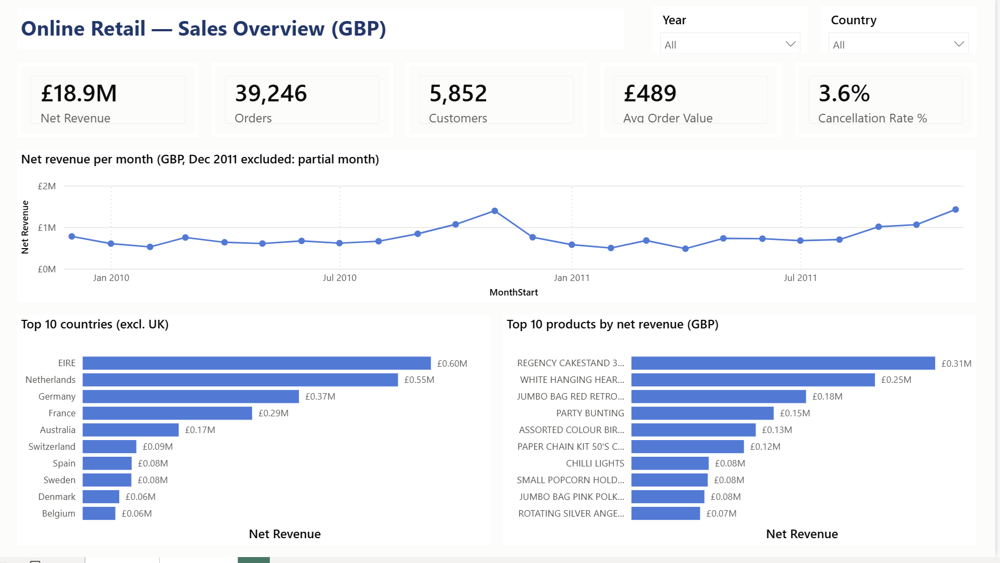
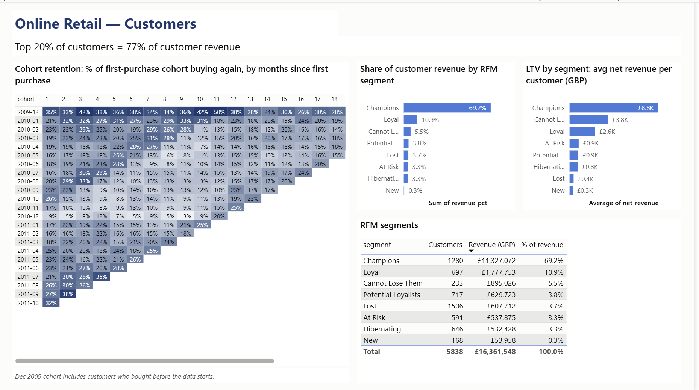

# Online Retail II Analysis

Two years of transactions from a UK online giftware wholesaler, cleaned, analysed in Python and presented in a Power BI dashboard covering revenue, seasonality, retention, RFM and customer value.



## Project Goal

Turn raw transactions into answers a business owner can act on:

- **Revenue:** how is it developing, and how seasonal is it?
- **Concentration:** which countries and products drive it?
- **Customers:** how well does the business keep them, who are the most valuable ones, and what is a customer worth?

The deliverables are reproducible notebooks, a documented cleaning log, charts, and a Power BI dashboard.

## Data

| | |
|---|---|
| Source | [Online Retail II](https://archive.ics.uci.edu/dataset/502/online+retail+ii), UCI Machine Learning Repository |
| Content | All transactions of a UK-based online retailer, mainly giftware sold to wholesale customers |
| Period | 1 December 2009 to 9 December 2011 |
| Size | 1,067,371 rows in two Excel sheets, `Year 2009-2010` and `Year 2010-2011` |
| In this repo | No. Download it as described in [How to Run](#how-to-run). |

| Column | Description |
|---|---|
| Invoice | Invoice number. A leading `C` marks a cancellation. |
| StockCode | Product code. Special codes such as POST, M or D are not products. |
| Description | Product name |
| Quantity | Units per line. Negative for cancellations. |
| InvoiceDate | Date and time of the invoice |
| Price | Unit price in GBP |
| Customer ID | 5-digit customer number. Can be empty. |
| Country | Customer's country |

## Project Structure

```
online-retail-analysis/
├── data/                        # not in the repo (git-ignored)
│   ├── raw/                     # online_retail_II.xlsx goes here
│   └── processed/               # parquet files and powerbi/*.csv, generated by the notebooks
├── notebooks/
│   ├── 01_data_loading_and_quality.ipynb   # load both sheets, data quality report
│   ├── 02_cleaning.ipynb                    # cleaning rules and cleaning log
│   └── 03_analysis.ipynb                    # KPIs, trends, cohorts, RFM, LTV, Power BI exports
├── src/
│   ├── load_data.py             # read Excel, cache as parquet
│   ├── clean_data.py            # cleaning steps and pipeline
│   └── analysis.py              # KPI, cohort, RFM and LTV functions, chart style
├── reports/
│   ├── data_quality.md          # raw data quality (notebook 01)
│   ├── cleaning_log.md          # rows removed per step (notebook 02)
│   ├── tables/                  # KPI table, cohort retention matrix
│   └── figures/                 # charts and dashboard screenshots
├── dashboard/
│   ├── online_retail.pbip       # Power BI project: open this file
│   ├── online_retail.SemanticModel/   # model in TMDL: tables, relationships, measures
│   ├── online_retail.Report/          # report in PBIR: two pages
│   ├── dashboard.pdf            # PDF export of the dashboard
│   ├── measures.dax             # all DAX measures with comments
│   ├── theme.json               # Power BI theme matching the Python charts
│   └── BUILD_GUIDE.md           # how the dashboard was built, step by step
├── requirements.txt
└── README.md
```

## How to Run

Requirements: Windows, Python 3.12 and Power BI Desktop.

**1. Get the data.** Open the [UCI dataset page](https://archive.ics.uci.edu/dataset/502/online+retail+ii) and click **Download**. Unzip the file and place it here:

```
data/raw/online_retail_II.xlsx
```

**2. Set up Python.** From the project root:

```powershell
python -m venv venv
.\venv\Scripts\Activate.ps1
pip install -r requirements.txt
```

**3. Run the notebooks in order.** The commands below regenerate the reports, the charts and `data/processed/powerbi/*.csv`:

```powershell
jupyter nbconvert --to notebook --execute --inplace notebooks/01_data_loading_and_quality.ipynb
jupyter nbconvert --to notebook --execute --inplace notebooks/02_cleaning.ipynb
jupyter nbconvert --to notebook --execute --inplace notebooks/03_analysis.ipynb
```

Notebook 01 reads the Excel file once, which takes a few minutes, and caches it as parquet. Later runs take seconds.

**4. Open the dashboard.** Open `dashboard/online_retail.pbip` in Power BI Desktop.

The model loads the CSVs from `E:\BI\mini\online-retail-analysis\data\processed\powerbi\`. If your project is in another folder, update the path:
1. Go to **Transform data > Data source settings**.
2. Select each of the five CSV files.
3. Click **Change Source**, then point it to your `data/processed/powerbi/` folder.
4. Click **Close & Apply**, then **Refresh**.

## Data Quality Notes

Full details are in [reports/data_quality.md](reports/data_quality.md) for the raw data and [reports/cleaning_log.md](reports/cleaning_log.md) for each cleaning step.

| Item | Result |
|---|---|
| Rows removed in cleaning | **3.8%**, 40,355 of 1,067,371 rows |
| Cancellation rate, all codes | **7.1%** of gross revenue |
| Cancellation rate, products only | **3.6%** of gross revenue |
| Revenue without Customer ID | **14%** of net revenue, 15% of gross |

**Removed rows:**
- **Sheet overlap:** the 1 to 9 December 2010 rows that appear in both sheets were removed from the second sheet.
- **Other removals:** exact duplicates, stock adjustments (negative quantity without a cancellation invoice), rows with Price of zero or less, and bad-debt adjustments.

**Why two cancellation rates?** Non-product codes are only 4% of gross revenue, but they carry half of all cancellation value. About £423K is manual adjustments and about £242K is Amazon fees. All analysis uses product rows, so 3.6% is the rate that reflects customer returns.

**Kept and flagged:** cancellations, rows without a Customer ID, non-product codes, December 2011 and very large quantities. Each has its own flag column instead of being removed.

**Description is standardised for display only.** Each StockCode shows its most frequent description. The original text is kept, and all analysis groups by StockCode.

## Analysis

All analysis is in [notebooks/03_analysis.ipynb](notebooks/03_analysis.ipynb), with the logic in [src/analysis.py](src/analysis.py).
- **Scope:** products only.
- **December 2011:** excluded from monthly trends and cohorts, but kept in all-time totals.

| Analysis | Question | Output |
|---|---|---|
| KPIs | How big is the business, and how did 2011 compare with 2010? | [kpis.csv](reports/tables/kpis.csv) |
| Monthly trend | How does revenue move through the year? | [01](reports/figures/01_monthly_net_revenue.png), [02](reports/figures/02_revenue_2010_vs_2011.png) |
| Countries and products | Where does revenue come from, and how concentrated is it? | [03](reports/figures/03_top_countries_excl_uk.png), [04](reports/figures/04_top_products.png), [05](reports/figures/05_pareto_products.png) |
| Cohort retention | How many new customers buy again, and when? | [06](reports/figures/06_cohort_retention_heatmap.png) |
| RFM segmentation | Which customers matter most, and who is drifting away? | [07](reports/figures/07_rfm_segments.png) |
| Customer lifetime value | What is a customer worth, overall and per segment? | [08](reports/figures/08_ltv.png) |

**Definitions:**
- **Net revenue** = sales + cancellations.
- **Gross revenue** = sales only.
- **Orders** = purchase invoices, excluding 270 orders that were later fully cancelled.
- **AOV** = order revenue / orders.

**All-time KPIs, products only:**

| Net revenue | Orders | Customers | Avg order value | Cancellation rate |
|---|---|---|---|---|
| £18.9M | 39,246 | 5,852 | £489 | 3.6% |

## Key Findings

The year-on-year comparisons cover January to November of 2010 and 2011.

| # | Finding | Business implication |
|---|---|---|
| 1 | **Revenue is flat, and bigger orders offset fewer orders.** Net revenue grew **+2.3%**, from £8.38M to £8.57M. Orders fell **3.6%** and AOV rose **5.5%**, from £475 to £501. | Growth has to come from order frequency and new customers. |
| 2 | **The business is highly seasonal.** September to November bring **41%** of January-November revenue. November peaks at **£1.43M**, about 3 times April. | Stock, staff and campaigns must be ready by August. |
| 3 | **Revenue is concentrated.** The top **20% of customers bring 77%** of customer revenue, and **22% of products make 80%** of product revenue. The **UK accounts for 85%**. | Key-account care for top customers. Win back the **233 "Cannot Lose Them" customers**, worth £895K, who have been inactive for about 11 months. |
| 4 | **Most new customers don't return.** About **21%** buy again in month 1 and in month 3. A new customer brings **£634** in 3 months and **£1,373** in 12. | A second-purchase program has a large payoff. Track month-1 retention as a core KPI. |
| 5 | **The 2011 cancellation spike is two bulk orders.** The rate rose from **2.5%** to **4.8%**, but two orders of 80,995 and 74,215 units, cancelled within minutes, account for about **£245K**. Without them the rate is **2.3%**. | Flag one-off bulk orders in KPI reporting, and check very large orders before booking them. |

## Dashboard

Power BI project: [dashboard/online_retail.pbip](dashboard/online_retail.pbip). PDF export: [dashboard/dashboard.pdf](dashboard/dashboard.pdf).

| Page | Answers |
|---|---|
| **Sales Overview** | How much does the business sell, and how is revenue developing month by month? Which countries outside the UK and which products bring the most revenue? Year and country can be filtered. |
| **Customers** | Do new customers come back? Which RFM segments hold the revenue? What is a customer worth in each segment? |



The measures are documented in [dashboard/measures.dax](dashboard/measures.dax), and the build steps in [dashboard/BUILD_GUIDE.md](dashboard/BUILD_GUIDE.md).

## Limitations

- **Revenue, not profit.** The data has no cost or margin, so a high-revenue product or customer is not necessarily profitable.
- **Mostly wholesale customers.** Order sizes, retention and LTV are not comparable with consumer e-commerce benchmarks.
- **UK-heavy.** The UK is 85% of revenue, so results for other countries rest on small samples.
- **December 2011 is partial.** The data ends on 9 December 2011, so that month is left out of trends and cohorts. Calendar-year totals for 2011 are not comparable with 2010.
- **The December 2009 cohort includes earlier customers.** It is the first month of data, so its "new" customers include long-standing ones. Retention and LTV are also shown without it.
- **Description is standardised for display.** Some wording changes over time are hidden. All analysis uses StockCode.
- **Missing Customer ID.** 14% of net revenue has no Customer ID and is excluded from cohort, RFM and LTV analysis.
- **Simple LTV.** LTV is a historical average, not a forecast, and it ignores margin and discounting.
